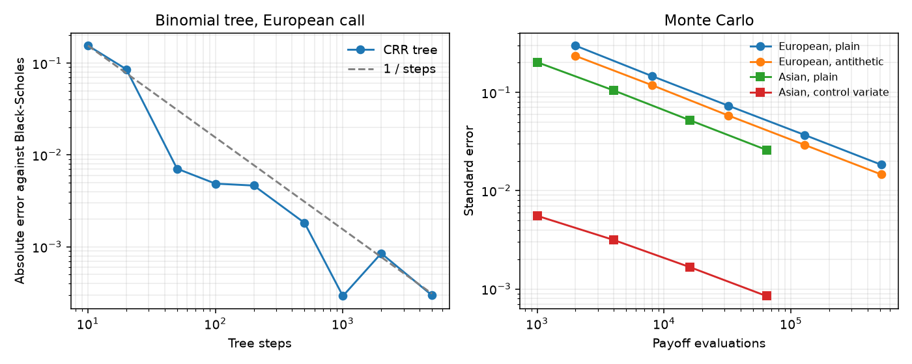

# derivative-pricing-lab

Three ways to price an option, written from the definitions and checked against each other: the Black-Scholes closed form, a binomial tree, and Monte Carlo simulation. Each method covers a case the others cannot, and every one is tested against something independent of itself.

Dependencies: NumPy only. The normal distribution comes from `math.erf`.

| Method | Prices | Checked against |
|---|---|---|
| Black-Scholes-Merton | European calls and puts with a dividend yield, five Greeks, implied volatility | Textbook values, put-call parity, finite differences |
| Cox-Ross-Rubinstein tree | European and American options | Black-Scholes in the limit, a one-step tree worked by hand, early-exercise theory |
| Monte Carlo | European options, arithmetic-average Asian options | Black-Scholes, the closed-form geometric Asian price |



## What the numbers show

All figures are for a call with spot 100, strike 105, rate 5%, volatility 20% and one year to expiry. The Black-Scholes price is 8.0214. Reproduce them with `python examples/convergence.py`.

### The tree converges at rate 1/steps, but not smoothly

| Steps | Absolute error |
|---:|---:|
| 10 | 0.15494 |
| 100 | 0.00488 |
| 1000 | 0.00029 |
| 2000 | 0.00085 |
| 5000 | 0.00030 |

The error at 2000 steps is larger than at 1000. This is expected. The strike falls at a different position between tree nodes each time the step count changes, so the error oscillates inside an envelope that shrinks like 1/steps. Doubling the steps does not guarantee a better answer, which is why a single tree price should not be trusted to more digits than the envelope allows.

### Antithetic sampling is a modest gain

| Payoff evaluations | Plain standard error | Antithetic standard error |
|---:|---:|---:|
| 2,000 | 0.29876 | 0.23491 |
| 32,000 | 0.07315 | 0.05818 |
| 512,000 | 0.01837 | 0.01464 |

Pairing each draw with its negative lowers the standard error by about 20% at equal cost. Both columns fall by half each time the work quadruples, the usual square-root rate. Antithetic sampling shifts the line down but does not change its slope.

### A control variate is a large gain

An Asian option on the arithmetic average has no closed form. The same option on the geometric average does, and the two payoffs are almost perfectly correlated. Pricing both on the same paths and correcting by the known error of the geometric one gives:

| Paths | Plain estimate | Std. error | Control variate estimate | Std. error |
|---:|---:|---:|---:|---:|
| 1,000 | 3.3305 | 0.20237 | 3.5784 | 0.00555 |
| 16,000 | 3.6030 | 0.05196 | 3.5949 | 0.00167 |
| 64,000 | 3.6267 | 0.02597 | 3.5958 | 0.00085 |

The standard error is about 30 times smaller. Plain sampling would need roughly 900 times as many paths to match it. With the control variate, 1,000 paths give a tighter answer than 64,000 without.

### Early exercise

With the same inputs, a 1000-step tree prices the European put at 7.9001 (Black-Scholes: 7.9004) and the American put at 8.7403. The 0.84 difference is the value of the right to exercise early. For a call on a stock that pays no dividend the tree gives the same price for both styles to twelve decimal places, as theory says it must.

## Usage

```python
from pricing import black_scholes as bs, binomial, monte_carlo

bs.price(100, 105, rate=0.05, vol=0.2, expiry=1.0, kind="call")        # 8.0214
bs.greeks(100, 105, 0.05, 0.2, 1.0)["delta"]                           # 0.5422
bs.implied_vol(8.0214, 100, 105, rate=0.05, expiry=1.0)                # 0.2000

binomial.price(100, 105, 0.05, 0.2, 1.0, steps=1000, kind="put", american=True)   # 8.7403

price, standard_error = monte_carlo.arithmetic_asian(
    100, 105, 0.05, 0.2, 1.0, fixings=50, paths=64_000, seed=1
)                                                                      # 3.5958, 0.00085
```

Every Monte Carlo pricer returns the estimate together with its standard error.

## Implementation notes

- **Implied volatility** uses Newton's method inside a bisection bracket. Newton is fast near the money but can overshoot where vega is close to zero. Any step that would leave the bracket is replaced by the midpoint, so the search always converges. A price outside the no-arbitrage range raises an error instead of returning a meaningless number.
- **Antithetic standard error** treats each pair of draws as one observation. Treating the two halves as independent samples would understate the error, because they are negatively correlated by construction.
- **Units of the Greeks.** Vega and rho are per unit change (1.00 of volatility or rate), and theta is per year. Divide vega and rho by 100 for the per-point figures, and theta by 365 for the per-day figure, that trading screens show.
- **The tree is vectorised** across nodes, with one NumPy operation per time step.

## Tests

```bash
pip install -e ".[dev]"
```

```bash
pytest -q
```

47 test cases, all deterministic. They include:

- put-call parity across strikes, with and without dividends;
- every Greek against a central finite difference of the price;
- implied volatility recovering its input from 8% to 90% volatility, in and out of the money;
- a one-step tree against the same calculation done by hand;
- Monte Carlo estimates falling within three standard errors of the exact price;
- a geometric Asian option with a single fixing reducing to a European option;
- the ordering that theory requires: American at least European, arithmetic Asian call above geometric, Asian call below European.

## Limits

- Constant volatility and rates throughout. No smile, no term structure.
- Dividends are a continuous yield. Discrete cash dividends are not handled.
- The tree has no smoothing or Richardson extrapolation, so it shows the raw oscillation described above.
- American options are priced by tree only. There is no Longstaff-Schwartz simulation.

## Layout

```
pricing/black_scholes.py   closed form, Greeks, implied volatility
pricing/binomial.py        CRR tree, European and American
pricing/monte_carlo.py     European and Asian pricers with variance reduction
examples/convergence.py    produces the chart and tables above
tests/test_pricing.py      pytest suite
```
